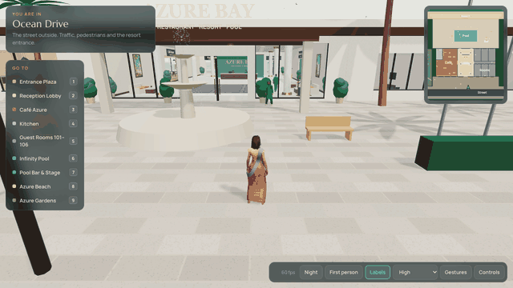
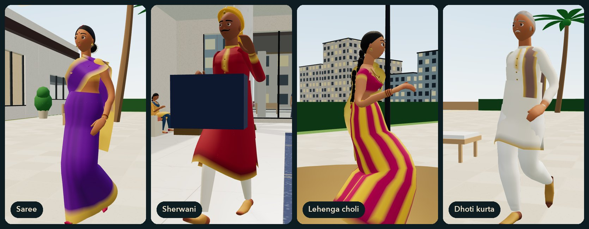
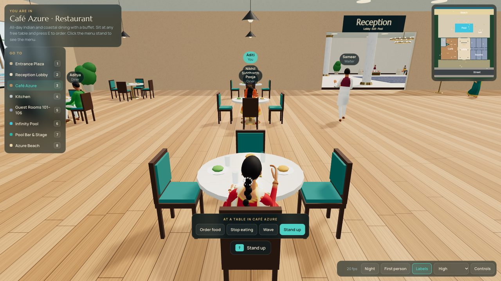
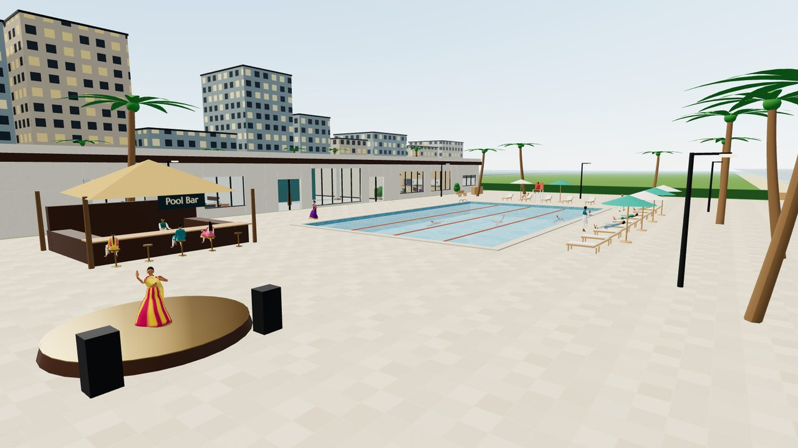
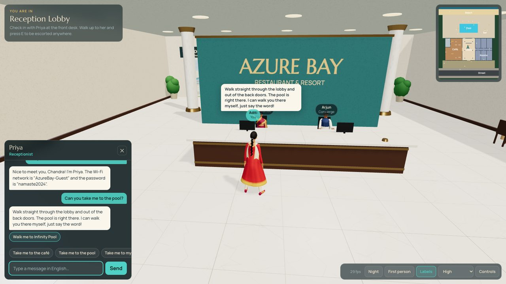
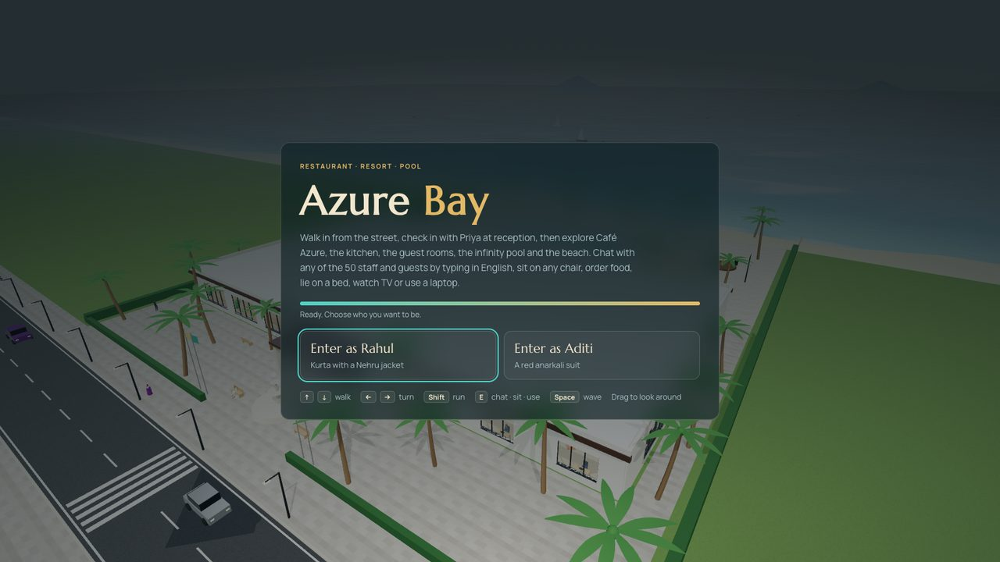
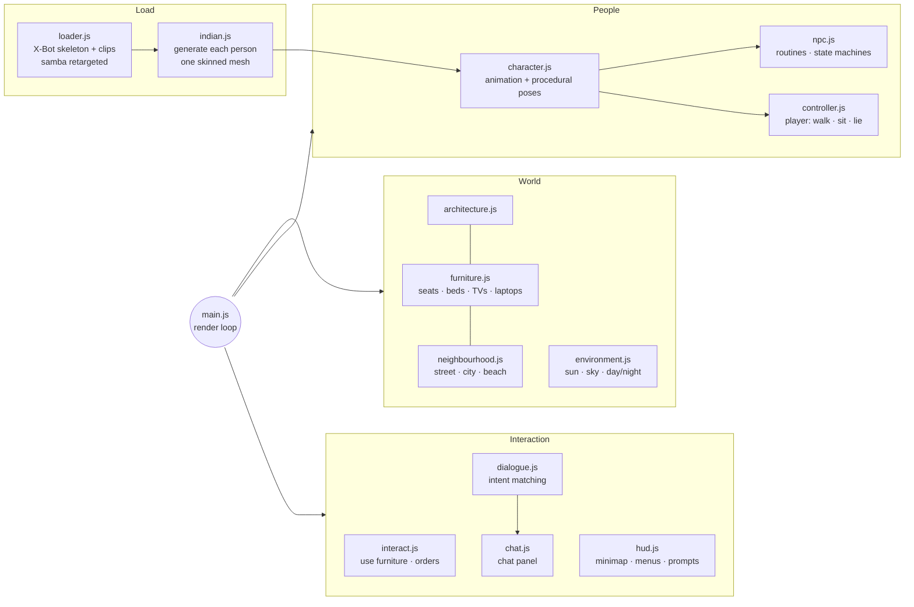

<a id="top"></a>

<p align="center">
  
</p>

<p align="center">
  <a href="https://threejs.org"></a>
  
  
  
  
</p>

<p align="center">
  <b><a href="#-quick-start">Quick start</a></b> ·
  <a href="#-meet-the-people">The people</a> ·
  <a href="#-everything-is-usable">What you can do</a> ·
  <a href="#-talk-to-anyone">Chat</a> ·
  <a href="#-controls">Controls</a> ·
  <a href="#-how-it-works">How it works</a> ·
  <a href="#-project-structure">Structure</a> ·
  <a href="#-deploy">Deploy</a>
</p>

<br>

**Azure Bay** is a 3D restaurant and resort you walk through in the browser. Enter from
the street, pass the fountain and the Sikh security guard, check in with Priya at reception,
then explore Café Azure, the kitchen, six guest rooms, the infinity pool, the pool bar and
the beach.

About fifty Indian staff and guests in traditional dress are living their day around you.
You can **type to any of them in English**, sit on any free chair, order food, lie on a bed,
switch on the TV or use a laptop. It is plain JavaScript and Three.js, with no build step and
no backend.

<p align="center">
  
  <br><sub>Walking into the entrance plaza, with the follow camera, minimap and quick-travel panel.</sub>
</p>

<table align="center">
  <tr>
    <td align="center" width="25%"><h2>51</h2><sub>people with their own routines</sub></td>
    <td align="center" width="25%"><h2>108</h2><sub>chairs, beds, TVs and laptops you can use</sub></td>
    <td align="center" width="25%"><h2>9</h2><sub>zones from the street to the beach</sub></td>
    <td align="center" width="25%"><h2>0</h2><sub>build steps, servers or API keys</sub></td>
  </tr>
</table>

---

## ✦ Highlights

<table>
  <tr>
    <td width="33%" valign="top">
      <h4>Traditional Indian cast</h4>
      Everyone is generated in code in a warm animated-film style: sarees, lehengas,
      anarkalis, sherwanis, dhoti-kurta, turbans, jhumkas and gajra.
    </td>
    <td width="33%" valign="top">
      <h4>Type to chat</h4>
      Offline, in-character replies about directions, the menu, prices, timings, Wi-Fi,
      weather and events. Replies can walk you somewhere or place an order.
    </td>
    <td width="33%" valign="top">
      <h4>Everything is usable</h4>
      Sit at any free table and order a masala dosa, lie in bed and watch the cricket,
      use the room laptop for room service, or sunbathe on a lounger.
    </td>
  </tr>
  <tr>
    <td valign="top">
      <h4>A living scene</h4>
      Waiters carry trays, the chef cooks, housekeeping makes beds, swimmers do laps, a dancer
      performs on the pool stage, and traffic and pedestrians pass on Ocean Drive.
    </td>
    <td valign="top">
      <h4>A receptionist state machine</h4>
      Priya greets you, stands up and walks you to the café, the pool or Room 104,
      waits if you fall behind, then returns to her desk.
    </td>
    <td valign="top">
      <h4>Runs anywhere</h4>
      Quality profiles with device detection, instancing, frustum culling and a pause when the
      tab is hidden. An on-screen joystick appears on phones.
    </td>
  </tr>
</table>

---

## ⚡ Quick start

ES modules need a web server, so opening `index.html` directly from disk will not work.

```bash
git clone https://github.com/Chm555556/Web-restaurant-3D.git
cd Web-restaurant-3D
python3 -m http.server 8000
```

Open **http://localhost:8000** and choose **Rahul** or **Aditi**. `npx serve .` or the
VS Code *Live Server* extension also work.

> [!TIP]
> Add `?quality=low`, `?quality=balanced` or `?quality=high` to the URL to force a graphics
> profile. You can also change it later from the toolbar.

---

## ✦ Meet the people

<p align="center">
  
</p>

<p align="center">
  
</p>

Every person is built at load time by [`characters/indian.js`](characters/indian.js) as **one
smooth skinned mesh** on the X-Bot skeleton. Walking, sitting, waving and dancing therefore
bend the saree pleats, the kurta hem and the braid along with the body.

| | Women | Men |
|---|---|---|
| **Face** | Big brown eyes with kajal and a winged liner, arched brows, rosy cheeks, soft smile | Big brown eyes, thick brows, moustache (classic or royal), optional beard |
| **Hair** | Centre parting with sindoor, bun with a jasmine gajra, long braid with a paranda, open hair | Side-parted quiff, grey for elders, Sikh pagri or Rajasthani safa |
| **Dress** | Silk saree with front pleats, zari border and pallu · lehenga choli · anarkali · salwar kameez with dupatta | Kurta pyjama with side slits · Nehru jacket · sherwani · dhoti-kurta with shawl · chef's whites · security uniform |
| **Jewellery** | Jhumkas, necklace and pendant, mangalsutra, maang tikka, nath, bangles, payal, mehndi | Kada, rudraksha mala, tilak |
| **Footwear** | Juttis | Mojaris (pointed tips) |

Women share the skeleton scaled to 1.65 m. Identical outfits share geometry, and each person
takes two draw calls: one for cloth and skin, one for gold.

---

## ✦ Everything is usable

<table>
  <tr>
    <td width="50%"><br><b>Café Azure.</b> Sit at any free table, press <b>Order food</b>, and your plate arrives a few seconds later.</td>
    <td width="50%"><br><b>Guest rooms.</b> Sit on the bed, lie down, sleep until morning, switch the TV on and flip channels.</td>
  </tr>
  <tr>
    <td><br><b>Laptops and the lobby computer.</b> Resort guide with travel, room service, weather and events, live cricket score, and notes saved in the browser.</td>
    <td><br><b>Pool deck.</b> Stools at the pool bar, fourteen sun loungers, a lifeguard tower and Bollywood dancing on the stage.</td>
  </tr>
</table>

| Where | What you can do |
|---|---|
| Café (48 seats) | Order from the menu, eat, chat with the diners next to you |
| Pool bar (5 stools) | Order a drink, sip it |
| Lobby sofas, plaza and pool benches | Sit, use your phone, wave |
| Guest rooms 101–106 | Bed (sit, lie down, sleep), armchair, desk with laptop, TV with 5 channels |
| Sun loungers (14) | Lie down, order a tender coconut |
| Lobby | Guest computer, menu stand, escort by the receptionist |

TV channels are drawn live into a canvas texture: *Cricket Live*, *Bollywood Music*,
*India News*, *Nature HD* and *Azure Bay TV*.

---

## ✦ Talk to anyone

<table>
  <tr>
    <td width="58%"></td>
    <td width="42%" valign="top">

**You:** *Namaste! My name is Chandra. What is the wifi password?*<br>
**Priya:** Nice to meet you, Chandra! The Wi-Fi network is "AzureBay-Guest" and the password is "namaste2024".

**You:** *Can you take me to the pool?*<br>
**Priya:** Walk straight through the lobby and out of the back doors. The pool is right there. I can walk you there myself, just say the word!<br>
<kbd>Walk me to Infinity Pool</kbd>

  </td>
  </tr>
</table>

Press <kbd>E</kbd> next to anyone, or click them and choose **Walk over and chat**. Replies
come from [`characters/dialogue.js`](characters/dialogue.js), an offline intent matcher that
answers in character using the facts in [`config.js`](config.js). Replies also appear as a
speech bubble above the character.

<details>
<summary><b>What they understand</b></summary>

<br>

| Intent | Examples |
|---|---|
| Greetings and small talk | *hi*, *namaste*, *sat sri akal*, *how are you*, *where are you from*, *tell me a joke* |
| Names | *my name is …* (remembered for the rest of the chat) |
| Directions | *where is the pool*, *take me to my room*, *how do I get to the beach* |
| Food and drink | *what's today's special*, *I'd like a masala dosa*, *one mango lassi please*, *anything vegetarian* |
| Prices | *how much is the biryani*, *room rate* |
| Timings | *when does the pool close*, *check-out time*, *when is Bollywood night* |
| Facilities | Wi-Fi, weather, events, safety, towels, luggage, cabs and tours |
| Role-specific | The concierge books cabs, the lifeguard knows the pool depth, the bellboy carries bags |

Answers can carry buttons: **Walk me there** (Priya escorts you), **Take me there**
(quick travel), **Show me the menu** and **Order …**. Staff take orders, and guests politely
point you to the waiter.

</details>

---

## ⌨ Controls

| Action | Keys |
|---|---|
| Walk forward / back | <kbd>↑</kbd> <kbd>↓</kbd> or <kbd>W</kbd> <kbd>S</kbd> |
| Turn | <kbd>←</kbd> <kbd>→</kbd> or <kbd>A</kbd> <kbd>D</kbd> |
| Run | hold <kbd>Shift</kbd> |
| Chat · sit · lie down · use a TV, laptop or computer | <kbd>E</kbd> |
| Stand up | <kbd>↑</kbd> or the button in the activity bar |
| Wave | <kbd>Space</kbd> |
| Look around · zoom | drag · scroll (pinch on phones) |
| First-person view | <kbd>C</kbd> |
| Day / night | <kbd>N</kbd> |
| Name labels | <kbd>L</kbd> |
| Quick travel | <kbd>1</kbd> – <kbd>8</kbd> |
| Reset camera | <kbd>R</kbd> |
| Close chat, laptop or panels | <kbd>Esc</kbd> |

On phones and tablets, an on-screen joystick and an **E** button appear.

<p align="center">
  
  
  <br><sub>Press <kbd>N</kbd> for evening, when the lamps, signs and pool lights come on (left). The start screen with its loading bar (right).</sub>
</p>

---

## ✦ How it works



<details>
<summary><b>Characters: from a skeleton to a person in a saree</b></summary>

<br>

1. **Skeleton.** `loader.js` loads the X-Bot glTF with its idle, walk and run clips.
   Michelle's samba is retargeted onto the same skeleton for the dancer.
2. **Body frame.** The bind pose is measured, and the hips define a local frame.
3. **Geometry.** A small builder emits rings, ellipsoids, tubes, tori and ribbons with
   **vertex colours and skin weights**: the torso profile, limbs, hands, sculpted head, eyes,
   lids, kajal, brows, nose, lips, hair caps, buns, braids, skirts with pleats and borders,
   the pallu and dupatta drapes, and jewellery.
4. **Skinning.** Skirts are weighted from the hips down to each thigh and shin, so they swing
   when walking and fold when sitting. Drapes follow the spine and shoulders, and braids
   follow the neck and back.
5. **Sharing.** Geometry is cached per outfit, and two shared materials (matte and gold) give
   each person two draw calls.

</details>

<details>
<summary><b>Living scene: routines, state machines and culling</b></summary>

<br>

- **Waypoint routes, no pathfinding.** `routes.js` runs scripts of steps: walk a path,
  pause, face, pose, say, sit.
- **The receptionist** runs `IDLE → TYPING → GREETING → STANDING → ESCORTING →
  WAITING/ARRIVED → RETURNING → SITTING`.
- **Procedural poses** in `character.js` layer sitting, eating, typing, waving, talking,
  carrying, stirring and swimming on top of the animation clips.
- **Culling.** People off-screen or far away are hidden and animate at a quarter or half rate.
  Static geometry is merged per material, and repeated props are instanced.

</details>

### Performance

| Profile | Shadows | Pixel ratio | Cast | Use it for |
|---|---|---|---|---|
| Lightweight | off | 1× | half | phones, older laptops |
| Balanced | 1024 px | up to 1.5× | full | most desktops |
| High | 2048 px, soft | up to 2× | full | discrete GPUs |

Measured on Balanced at the opening view: about **280 draw calls** and **840k triangles**,
including the shadow pass. Models and textures total **3.5 MB**, and Three.js adds **0.8 MB**.

---

## ✦ Project structure

```text
├── index.html              Page, HUD markup and styles (glass UI), import map
├── main.js                 Scene, renderer, render loop, input, wiring
├── config.js               Names, zones, escort routes, menu, resort facts, quality profiles
├── characters/
│   ├── indian.js           Generates every person: body, face, hair, dress, jewellery
│   ├── dialogue.js         Offline chat: intents and in-character replies
│   ├── character.js        One animated person: clips, crossfades, procedural poses
│   ├── npc.js              The cast and their routines, receptionist state machine
│   ├── controller.js       The player: movement, collisions, sit / lie / stand
│   └── loader.js           glTF loading, retargeting, measurements
├── scene/
│   ├── architecture.js     Building shell, walls, doors, pool, signs
│   ├── furniture.js        Furniture, TVs and channels, laptops, guest computer, anchors
│   ├── neighbourhood.js    Street, city blocks, beach, boats
│   ├── environment.js      Sky, three-light setup, fog, day / night
│   ├── materials.js        Shared material cache and generated textures
│   └── helpers.js          Instancing, static batching, geometry helpers
├── systems/
│   ├── interact.js         Usable furniture and devices, orders, activity bar
│   ├── routes.js           Waypoint paths and step scripts
│   ├── camera.js           Follow and first-person camera
│   ├── collision.js        Box colliders, camera ray-casts
│   ├── traffic.js          Cars, airplane
│   └── performance.js      Device detection, FPS meter, pause when hidden
├── ui/
│   ├── hud.js              Zone card, minimap, travel, menus, panels
│   └── chat.js             Chat panel
├── assets/models/          X-Bot (skeleton + clips), Michelle (samba clip)
├── vendor/                 Three.js r170 and the addons used
└── _headers                Cache headers for Netlify / Cloudflare Pages
```

---

## ✦ Customize

Almost everything a non-programmer might change lives in [`config.js`](config.js):

| Change | Where |
|---|---|
| Resort name, tagline, zones and their descriptions | `CONFIG.name`, `CONFIG.zones` |
| Quick-travel order (keys 1–8) | `CONFIG.travel` |
| Where Priya can escort you, and what she says on arrival | `CONFIG.escort` |
| Café menu and prices (₹) | `CONFIG.menu` |
| Wi-Fi, opening hours, events and weather used in chat | `CONFIG.info` |
| Walking speed, camera, graphics profiles | `CONFIG.player`, `CONFIG.camera`, `CONFIG.quality` |

People, outfits and routines are in [`characters/npc.js`](characters/npc.js). An outfit is
one line:

```js
D.saree({ main: 0x8b1538, blouse: 0xe3b33f, hair: 'bun', sindoor: true, skin: 'wheat' })
D.sherwani({ main: 0xa31d24, safa: 0xf2a900, mustache: 'royal', skin: 'dusky' })
```

Styles: `saree`, `lehenga`, `anarkali`, `salwar`, `kurta`, `sherwani`, `dhoti`, `chef`,
`guard`, `tee`, `swim`, `swimF`. Skin tones: `fair`, `wheat`, `medium`, `dusky`, `deep`.

---

## ✦ Deploy

The site is static files only.

| Host | How |
|---|---|
| **GitHub Pages** | *Settings → Pages → Deploy from a branch → `main` / root.* |
| **Netlify** | Drag the folder onto the Netlify dashboard. `_headers` is applied automatically. |
| **Cloudflare Pages** | Connect the repository with no build command and output directory `/`. |

`_headers` caches `assets/` and `vendor/` for a year and never caches HTML, so visitors
always get the latest version. `azure-bay.html` is a variant for hosts that cannot serve
`.glb` files: it loads embedded `.gltf.json` models instead.

---

## ✦ Known limitations

- The characters are stylised, not photo-real, and have no individual hair strands or
  fabric textures.
- Chat is rule-based and offline. Unusual questions get a polite *"I'm not sure, try asking
  about…"*.
- When someone lies down in a wide lehenga or anarkali, the hem lifts a little.

## ✦ Credits

- [Three.js](https://threejs.org) r170 (MIT).
- Skeleton and animation clips: *X-Bot* and *Michelle* from the three.js examples
  (originally Mixamo), optimised with gltf-transform. *Soldier* and *RobotExpressive* are
  kept in `assets/models/` but are not loaded.
- Every body, face, costume, building, prop, texture, sign and TV programme is generated in
  code.

<p align="center"><br><a href="#top">Back to top ↑</a></p>
