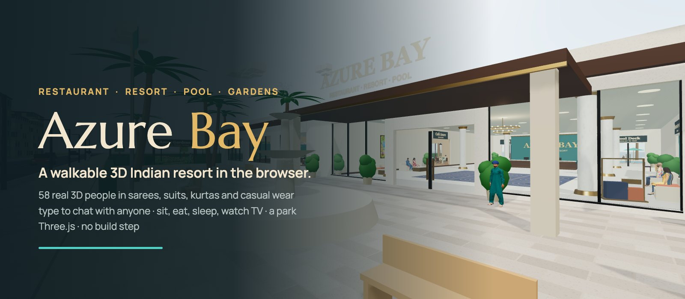
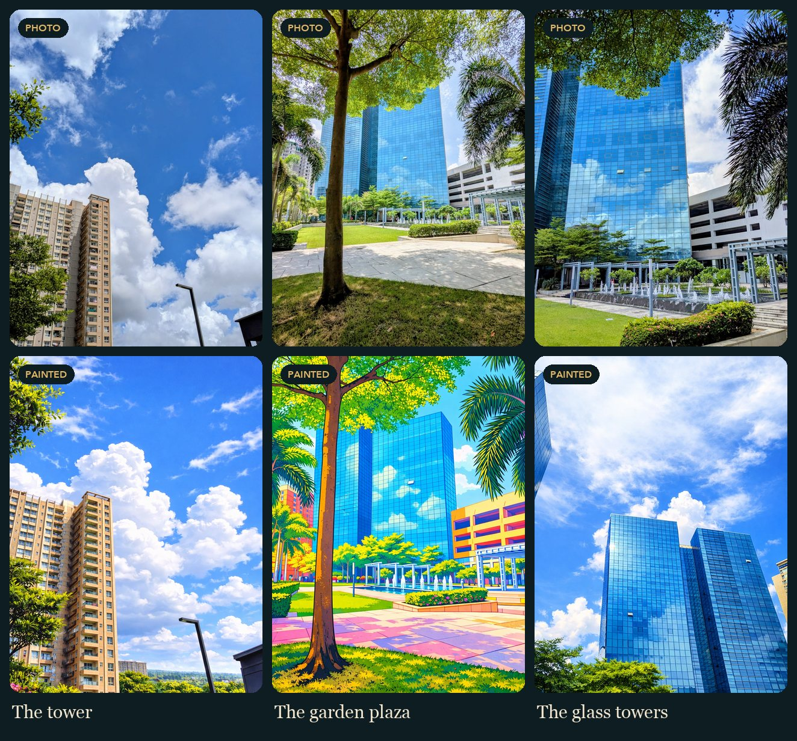
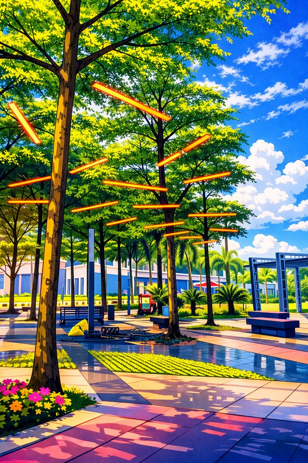
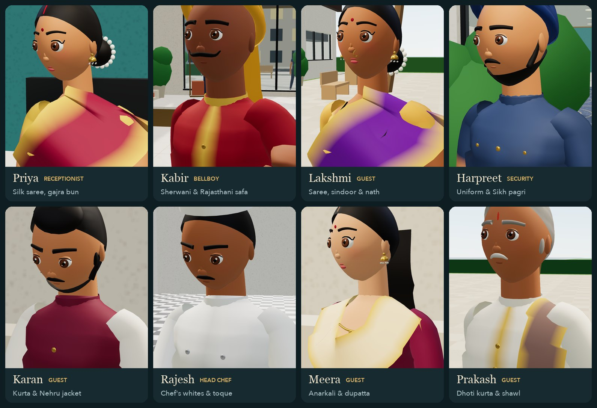
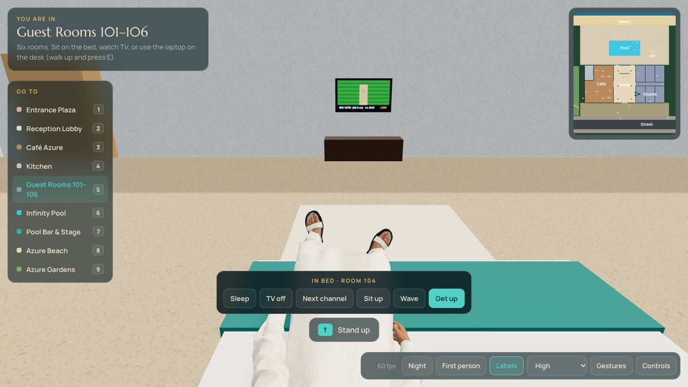
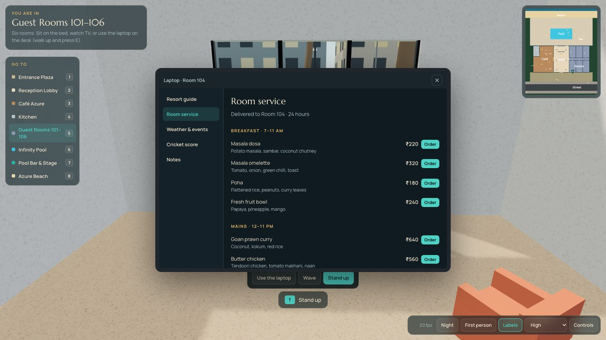
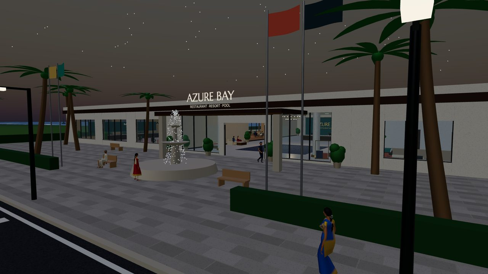
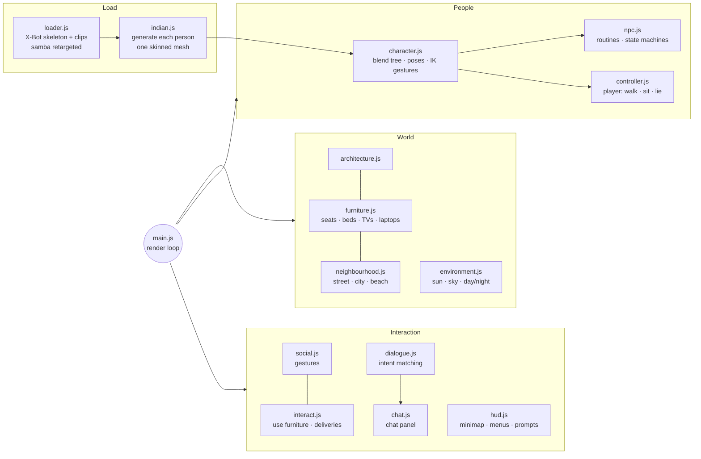

<a id="top"></a>

<p align="center">
  
</p>

<p align="center">
  <a href="https://threejs.org"></a>
  
  
  
  
</p>

<p align="center">
  <b><a href="#-quick-start">Quick start</a></b> ·
  <a href="#-from-real-places-to-the-resort">Inspiration</a> ·
  <a href="#-meet-the-people">The people</a> ·
  <a href="#-everything-is-usable">What you can do</a> ·
  <a href="#-talk-to-anyone">Chat</a> ·
  <a href="#-controls">Controls</a> ·
  <a href="#-how-it-works">How it works</a> ·
  <a href="#-project-structure">Structure</a> ·
  <a href="#-deploy">Deploy</a>
</p>

<br>

**Azure Bay** is a 3D restaurant and resort you walk through in the browser. Enter from
the street, pass the fountain and the Sikh security guard, check in with Priya at reception,
then explore Café Azure, the kitchen, six guest rooms, the infinity pool, the pool bar and
the beach.

About fifty Indian staff and guests in traditional dress are living their day around you.
You can **type to any of them in English**, sit on any free chair, order food, lie on a bed,
switch on the TV or use a laptop. It is plain JavaScript and Three.js, with no build step and
no backend.

<p align="center">
  
  <br><sub>Walking into the entrance plaza, with the follow camera, minimap and quick-travel panel.</sub>
</p>

<table align="center">
  <tr>
    <td align="center" width="25%"><h2>51</h2><sub>people with their own routines</sub></td>
    <td align="center" width="25%"><h2>108</h2><sub>chairs, beds, TVs and laptops you can use</sub></td>
    <td align="center" width="25%"><h2>9</h2><sub>zones from the street to the beach</sub></td>
    <td align="center" width="25%"><h2>0</h2><sub>build steps, servers or API keys</sub></td>
  </tr>
</table>

---

## ✦ Highlights

<table>
  <tr>
    <td width="33%" valign="top">
      <h4>Traditional Indian cast</h4>
      Everyone is generated in code in a warm animated-film style: sarees, lehengas,
      anarkalis, sherwanis, dhoti-kurta, turbans, jhumkas and gajra.
    </td>
    <td width="33%" valign="top">
      <h4>Type to chat</h4>
      Offline, in-character replies about directions, the menu, prices, timings, Wi-Fi,
      weather and events. Replies can walk you somewhere or place an order.
    </td>
    <td width="33%" valign="top">
      <h4>Everything is usable</h4>
      Sit at any free table and order a masala dosa, lie in bed and watch the cricket,
      use the room laptop for room service, or sunbathe on a lounger.
    </td>
  </tr>
  <tr>
    <td valign="top">
      <h4>A living scene</h4>
      Waiters carry trays, the chef cooks, housekeeping makes beds, swimmers do laps, a dancer
      performs on the pool stage, and traffic and pedestrians pass on Ocean Drive.
    </td>
    <td valign="top">
      <h4>A receptionist state machine</h4>
      Priya greets you, stands up and walks you to the café, the pool or Room 104,
      waits if you fall behind, then returns to her desk.
    </td>
    <td valign="top">
      <h4>Runs anywhere</h4>
      Quality profiles with device detection, instancing, frustum culling and a pause when the
      tab is hidden. An on-screen joystick appears on phones.
    </td>
  </tr>
</table>

---

## ✦ From real places to the resort

<p align="center">
  
</p>

Azure Bay's look grew out of real photographs: a residential tower against monsoon clouds,
a garden plaza with fountains and pergolas, and mirrored glass towers. Each photo was turned
into a bright, hand-painted-style version, and these images now live inside the project:

<table>
  <tr>
    <td width="62%" valign="top">

| Where | Image |
|---|---|
| **Start screen** | The painted garden plaza, softly blurred behind the welcome card while the resort loads. It fades to the live 3D fly-over once everything is ready. |
| **Lobby** | Two large framed paintings above the sofas: the garden plaza and the tower. |
| **Guest rooms 101–106** | A framed photo or painting above every bed. |

All of them are in [`assets/images/`](assets/images), resized to 1024 px (about 1.5 MB in
total). To hang your own, replace a file there with one of the same name, or add a `hang(...)`
line in [`scene/furniture.js`](scene/furniture.js).

  </td>
    <td width="38%" valign="top"><br><sub>The painted park, hanging in Room 105.</sub></td>
  </tr>
</table>

---

## ⚡ Quick start

ES modules need a web server, so opening `index.html` directly from disk will not work.

```bash
git clone https://github.com/Chm555556/Web-restaurant-3D.git
cd Web-restaurant-3D
python3 -m http.server 8000
```

Open **http://localhost:8000** and choose **Rahul** or **Aditi**. `npx serve .` or the
VS Code *Live Server* extension also work.

> [!TIP]
> Add `?quality=low`, `?quality=balanced` or `?quality=high` to the URL to force a graphics
> profile. You can also change it later from the toolbar.

---

## ✦ Meet the people

<p align="center">
  
</p>

<p align="center">
  
</p>

Every person is built at load time by [`characters/indian.js`](characters/indian.js) as **one
smooth skinned mesh** on the X-Bot skeleton. Walking, sitting, waving and dancing therefore
bend the saree pleats, the kurta hem and the braid along with the body.

| | Women | Men |
|---|---|---|
| **Face** | Big brown eyes with kajal and a winged liner, arched brows, rosy cheeks, soft smile | Big brown eyes, thick brows, moustache (classic or royal), optional beard |
| **Hair** | Centre parting with sindoor, bun with a jasmine gajra, long braid with a paranda, open hair | Side-parted quiff, grey for elders, Sikh pagri or Rajasthani safa |
| **Dress** | Silk saree with front pleats, zari border and pallu · lehenga choli · anarkali · salwar kameez with dupatta | Kurta pyjama with side slits · Nehru jacket · sherwani · dhoti-kurta with shawl · chef's whites · security uniform |
| **Jewellery** | Jhumkas, necklace and pendant, mangalsutra, maang tikka, nath, bangles, payal, mehndi | Kada, rudraksha mala, tilak |
| **Footwear** | Juttis | Mojaris (pointed tips) |

Women share the skeleton scaled to 1.65 m. Identical outfits share geometry, and each person
takes two draw calls: one for cloth and skin, one for gold.

---

## ✦ Everything is usable

<table>
  <tr>
    <td width="50%"><br><b>Café Azure.</b> Sit at any free table and press <b>Order food</b>. Sameer collects it at the kitchen pass, carries it over on a tray and serves it at your table.</td>
    <td width="50%"><br><b>Guest rooms.</b> Sit on the bed, lie down, sleep until morning, switch the TV on and flip channels.</td>
  </tr>
  <tr>
    <td><br><b>Laptops and the lobby computer.</b> Resort guide with travel, room service, weather and events, live cricket score, and notes saved in the browser.</td>
    <td><br><b>Pool deck.</b> Stools at the pool bar, fourteen sun loungers, a lifeguard tower and Bollywood dancing on the stage.</td>
  </tr>
</table>

| Where | What you can do |
|---|---|
| Café (48 seats) | Order from the menu (the waiter brings it), eat, chat with the diners next to you |
| Pool bar (5 stools) | Order a drink (the bartender mixes and serves it), sip it |
| Lobby sofas, plaza and pool benches | Sit, use your phone, wave |
| Guest rooms 101–106 | Doors you open and close, bed (sit, lie down, sleep), armchair, desk with laptop, TV with 5 channels, room service delivered to the room |
| Sun loungers (14) | Lie down, order a tender coconut (the pool server brings it) |
| Lobby | Guest computer, menu stand, escort by the receptionist |

TV channels are drawn live into a canvas texture: *Cricket Live*, *Bollywood Music*,
*India News*, *Nature HD* and *Azure Bay TV*.

### Real doors, real deliveries

- **Doors.** The room and kitchen doors stay shut until someone opens them. Walk up and
  press <kbd>E</kbd> to open or close one. A closed door blocks the way, hides whoever is
  behind it and swings shut by itself once everyone has gone. Staff and guests stop at a
  door, reach for the handle and walk through.
- **Deliveries.** Every order is carried by a person:

  | You order from | Who brings it | Route |
  |---|---|---|
  | A café table, the lobby or the plaza | Sameer, the waiter | Kitchen pass → your table |
  | A bar stool | Joseph, the bartender | Mixes it, then serves it across the counter |
  | A sun lounger or the pool deck | Mohan, the pool server | Pool bar → your lounger |
  | Your room (bed, desk, armchair or laptop) | Vikram, room service | Pantry trolley → corridor → knocks on your door → opens it → serves you |

  Paths are found on a walkable grid baked from the collision boxes, with A* and
  string-pulling, so nobody walks through a table, chair or wall.
- **Sitting.** Chairs are solid. Press <kbd>E</kbd> and you walk round the table to the
  free side, turn and lower yourself into the seat, then lean back. Standing up and lying
  down are animated too, with no fade to black.

### Gestures

Press <kbd>G</kbd> (or **Gestures**) for 🙏 namaste, 🤝 handshake, ✋ high five, 👋 wave,
🙇 bow, 👏 clap, 🙌 cheer, 💃 dance, 😄 laugh, nod, shake head and 🤔 think. The person
you face answers: a namaste for a namaste, a wave back, a laugh, sometimes a dance.
Handshakes and high fives bring you to arm's length, and two-bone arm IK sends both right
hands to the same point, so the hands really meet. This works with seated people too. In
chat, typing *shake hands*, *high five*, *let's dance*, *namaste* or *tell me a joke* plays
the matching move.

---

## ✦ Talk to anyone

<table>
  <tr>
    <td width="58%"></td>
    <td width="42%" valign="top">

**You:** *Namaste! My name is Chandra. What is the wifi password?*<br>
**Priya:** Nice to meet you, Chandra! The Wi-Fi network is "AzureBay-Guest" and the password is "namaste2024".

**You:** *Can you take me to the pool?*<br>
**Priya:** Walk straight through the lobby and out of the back doors. The pool is right there. I can walk you there myself, just say the word!<br>
<kbd>Walk me to Infinity Pool</kbd>

  </td>
  </tr>
</table>

Press <kbd>E</kbd> next to anyone, or click them and choose **Walk over and chat**. Replies
come from [`characters/dialogue.js`](characters/dialogue.js), an offline intent matcher that
answers in character using the facts in [`config.js`](config.js). Replies also appear as a
speech bubble above the character.

<details>
<summary><b>What they understand</b></summary>

<br>

| Intent | Examples |
|---|---|
| Greetings and small talk | *hi*, *namaste*, *sat sri akal*, *how are you*, *where are you from*, *tell me a joke* |
| Names | *my name is …* (remembered for the rest of the chat) |
| Directions | *where is the pool*, *take me to my room*, *how do I get to the beach* |
| Food and drink | *what's today's special*, *I'd like a masala dosa*, *one mango lassi please*, *anything vegetarian* |
| Prices | *how much is the biryani*, *room rate* |
| Timings | *when does the pool close*, *check-out time*, *when is Bollywood night* |
| Facilities | Wi-Fi, weather, events, safety, towels, luggage, cabs and tours |
| Role-specific | The concierge books cabs, the lifeguard knows the pool depth, the bellboy carries bags |

Answers can carry buttons: **Walk me there** (Priya escorts you), **Take me there**
(quick travel), **Show me the menu** and **Order …**. Staff take orders, and guests politely
point you to the waiter.

</details>

---

## ⌨ Controls

| Action | Keys |
|---|---|
| Walk forward / back | <kbd>↑</kbd> <kbd>↓</kbd> or <kbd>W</kbd> <kbd>S</kbd> |
| Turn | <kbd>←</kbd> <kbd>→</kbd> or <kbd>A</kbd> <kbd>D</kbd> |
| Run | hold <kbd>Shift</kbd> |
| Chat · sit · lie down · use a TV, laptop or computer | <kbd>E</kbd> |
| Stand up | <kbd>↑</kbd> or the button in the activity bar |
| Wave | <kbd>Space</kbd> |
| Look around · zoom | drag · scroll (pinch on phones) |
| First-person view | <kbd>C</kbd> |
| Day / night | <kbd>N</kbd> |
| Name labels | <kbd>L</kbd> |
| Quick travel | <kbd>1</kbd> – <kbd>8</kbd> |
| Reset camera | <kbd>R</kbd> |
| Open / close a room or kitchen door | <kbd>E</kbd> |
| Gestures (namaste, handshake, high five…) | <kbd>G</kbd> |
| Close chat, laptop or panels | <kbd>Esc</kbd> |

On phones and tablets, an on-screen joystick and an **E** button appear.

<p align="center">
  
  
  <br><sub>Press <kbd>N</kbd> for evening, when the lamps, signs and pool lights come on (left). The start screen with its loading bar (right).</sub>
</p>

---

## ✦ How it works



<details>
<summary><b>Characters: from a skeleton to a person in a saree</b></summary>

<br>

1. **Skeleton.** `loader.js` loads the X-Bot glTF with its idle, walk and run clips.
   Michelle's samba is retargeted onto the same skeleton for the dancer.
2. **Body frame.** The bind pose is measured, and the hips define a local frame.
3. **Geometry.** A small builder emits rings, ellipsoids, tubes, tori and ribbons with
   **vertex colours and skin weights**: the torso profile, limbs, hands, sculpted head, eyes,
   lids, kajal, brows, nose, lips, hair caps, buns, braids, skirts with pleats and borders,
   the pallu and dupatta drapes, and jewellery.
4. **Skinning.** Skirts are weighted from the hips down to each thigh and shin, so they swing
   when walking and fold when sitting. Drapes follow the spine and shoulders, and braids
   follow the neck and back.
5. **Sharing.** Geometry is cached per outfit, and two shared materials (matte and gold) give
   each person two draw calls.

</details>

<details>
<summary><b>Living scene: routines, state machines and culling</b></summary>

<br>

- **Scripted routines on a nav grid.** `routes.js` runs scripts of steps: walk a path,
  pause, face, pose, say, sit. Any leg that would cut through furniture is re-routed by
  `nav.js` (A* on a 0.35 m grid baked from the colliders, then string-pulled). Walkers ease
  in and out of speed, slow down for sharp corners and stop at closed doors to open them.
- **Natural locomotion.** Idle, walk and run play together as a blend tree driven by the
  real ground speed. Walk and run share one phase so their footfalls line up, and the clip
  rates are calibrated from the measured stride (walk 1.44 m/s, run 3.34 m/s), so the feet
  don't slide. Bodies lean into speed and turns, and heads turn toward nearby people.
- **Gestures with arm IK.** Namaste, handshake, high five, clap and the rest place the
  hands with two-bone IK relative to the chest, so the same gesture fits men, women and
  seated people.
- **The receptionist** runs `IDLE → TYPING → GREETING → STANDING → ESCORTING →
  WAITING/ARRIVED → RETURNING → SITTING`.
- **Procedural poses** in `character.js` layer sitting, eating, typing, waving, talking,
  carrying, stirring and swimming on top of the animation clips.
- **Culling.** People off-screen or far away are hidden and animate at a quarter or half rate.
  Static geometry is merged per material, and repeated props are instanced.

</details>

### Performance

| Profile | Shadows | Pixel ratio | Cast | Use it for |
|---|---|---|---|---|
| Lightweight | off | 1× | half | phones, older laptops |
| Balanced | 1024 px | up to 1.5× | full | most desktops |
| High | 2048 px, soft | up to 2× | full | discrete GPUs |

Measured on Balanced at the opening view: about **280 draw calls** and **840k triangles**,
including the shadow pass. Models and textures total **3.5 MB**, and Three.js adds **0.8 MB**.

---

## ✦ Project structure

```text
├── index.html              Page, HUD markup and styles (glass UI), import map
├── main.js                 Scene, renderer, render loop, input, wiring
├── config.js               Names, zones, escort routes, menu, resort facts, quality profiles
├── characters/
│   ├── indian.js           Generates every person: body, face, hair, dress, jewellery
│   ├── dialogue.js         Offline chat: intents and in-character replies
│   ├── character.js        One animated person: locomotion blend tree, poses, IK gestures, look-at
│   ├── npc.js              The cast, routines, deliveries, gesture reactions, receptionist
│   ├── controller.js       The player: acceleration, collisions, animated sit / lie / stand
│   └── loader.js           glTF loading, retargeting, measurements
├── scene/
│   ├── architecture.js     Building shell, walls, pool, signs, doors (sliding + real swing doors)
│   ├── furniture.js        Furniture, TVs and channels, laptops, guest computer, anchors
│   ├── neighbourhood.js    Street, city blocks, beach, boats
│   ├── environment.js      Sky, three-light setup, fog, day / night
│   ├── materials.js        Shared material cache and generated textures
│   └── helpers.js          Instancing, static batching, geometry helpers
├── systems/
│   ├── interact.js         Usable furniture and devices, orders and who delivers them
│   ├── social.js           Gestures between you and the people around you
│   ├── nav.js              Walkable grid, A* path finding, path smoothing
│   ├── routes.js           Steering (easing, turning, door stops) and step scripts
│   ├── camera.js           Follow and first-person camera
│   ├── collision.js        Box colliders, camera ray-casts
│   ├── traffic.js          Cars, airplane
│   └── performance.js      Device detection, FPS meter, pause when hidden
├── ui/
│   ├── hud.js              Zone card, minimap, travel, menus, panels
│   └── chat.js             Chat panel
├── assets/models/          X-Bot (skeleton + clips), Michelle (samba clip)
├── assets/images/          Photos and paintings: start screen, lobby and room art
├── assets/people/          Optional real 3D people (see "Real 3D people")
├── tools/import-model.sh   Convert, shrink and install a downloaded model
├── vendor/                 Three.js r170 and the addons used
└── _headers                Cache headers for Netlify / Cloudflare Pages
```

---

## ✦ Real 3D people (optional)

You can swap the generated characters for downloaded, sculpted 3D people. They get the same
walk, run, sit, lie, swim, door and gesture behaviour as everyone else, because the clips
are retargeted onto their skeleton when the page loads.

1. **Download** the model from Sketchfab: *Download 3D Model → glTF (.glb)*. You need a
   free Sketchfab account.
2. **Rig it if needed.** If the model has no skeleton, upload it to
   [mixamo.com](https://www.mixamo.com), let it auto-rig, then download
   *FBX Binary, With Skin, T-pose*.
3. **Install it:**

   ```bash
   tools/import-model.sh ~/Downloads/indian_man_in_kurta.glb indian-man-in-kurta
   ```

   This converts FBX to glTF, halves the triangle count, shrinks the textures to 1024 px
   WebP and registers the file in `assets/people/index.json`. You need Node.js. Pass a third
   argument to keep more or fewer triangles, e.g. `0.3` for a very heavy model.
4. **Reload.** In `CONFIG.people`:
   - `base: 'kurta'`, `'saree'` or `'suit'` makes a model the body that men, saree women or
     suit women are built from.
   - `face: true` lends only the model's head, so it needs the same skeleton family.
   - `use: [...]` gives the model to the named cast members only.
   - `player: 'm'` or `'f'` makes it your own character.

   A model that isn't installed falls back to the generated character.

### Everyone is their own person

Men wear a kurta-pyjama (plain, striped, checked or dotted), a polo with jeans or chinos, a
printed shirt with jeans, or a T-shirt with shorts by the pool and on the beach. Staff and
older men wear kurtas. Women wear a saree, or a salwar suit (kameez, churidar and
dupatta). No two look alike (`characters/looks.js`):

- **Real faces.** The Nodeaxis models share one skeleton per sex, so their heads can be put
  on any body of that family. That gives five men's faces and six women's faces, plus the
  village woman's own face. Every face is then reshaped a little: its width, jaw, length
  and depth.
- **Clothes.** Saree women use the *Indian Woman in Saree* body. The saree print is turned
  round the colour wheel to each woman's colour from the cast list, so the print stays.
  Suit women use the *Indian Office Woman* body: the dress becomes a kameez (plain,
  bandhani dots, block-print stripes or checks), the legs a gathered churidar, and a
  dupatta fitted to her body is draped round the neck. Lakshmi is the village woman in her
  yellow saree.
- **Skin, hair and make-up.** Skin tone comes from the cast list (`skin: 'fair'` … `'deep'`).
  Hair is toned to black or brown, and older people (`grey: true`) go grey. Women get their
  own lipstick. Men with `beard` or `mustache` get one.
- **Height and build** vary by about ±5 %.
- **Details.** Bindi, nose ring, earrings, gajra flowers, glasses, tilak, a turban (Harpreet)
  and a chef's cap (the chefs).
- **Staff.** Women on the staff wear the resort saree (teal with an orange print). Men wear
  a teal kurta with a cream pyjama.
- **You.** Aditi is the *Free fire character in Indian look* exactly as made: her own face,
  pink saree, purple pallu and yellow blouse. Rahul keeps the kurta model's own face.

The animation is retargeted by **direction**: each bone of the model is first turned to
point the way the X-Bot's bone points, and only then are the X-Bot's movements copied. This
works even when a model was rigged with its arms down (Mixamo's auto-rig of an A-pose
mesh). The hips keep the clip's bounce and sway, scaled to the model's leg length.

Women in a saree take shorter, quicker steps. The cloth is shared between both legs, so
it hangs like a saree instead of splitting into trouser legs. People far from the camera
switch to a low-detail copy of their model (`assets/people/lod/`, made by
`tools/import-model.sh`). Their eyes and jewellery are hidden, because nobody can see them
at that distance.

| Model | Author | Licence | Status | Used for |
|---|---|---|---|---|
| [Indian Man In Kurta](https://sketchfab.com/3d-models/indian-man-in-kurta-a7fcb7ce36984b1b860ac7e476033bb1) | Nodeaxis Interactive | Sketchfab Free Standard | installed (base) | Every man's body and kurta; Rahul (you) and the grey-haired men keep its face |
| [Indian Teenager](https://sketchfab.com/3d-models/indian-teenager-b2804b40f671431ca7b5cc53b239175e) | Nodeaxis Interactive | CC BY 4.0 | installed (base: polo) | Polo and jeans; one of the five male faces |
| [Indian Man In Tshirt](https://sketchfab.com/3d-models/indian-man-in-tshirt-091381a4eeb14e3b9814e3aaf075ac59) | Nodeaxis Interactive | CC BY 4.0 | installed (base: shirt) | Printed shirt and jeans; one of the five male faces |
| [Indian Football Fan](https://sketchfab.com/3d-models/indian-football-fan-cf50624deae649ddbfccae9f4f213e6c) | Nodeaxis Interactive | CC BY 4.0 | installed (face) | One of the five male faces |
| [Indian man, Punching Bag](https://sketchfab.com/3d-models/indian-man-punching-bag-8408c80ccd9548e4bad84bc0dd8e0d7e) | Nodeaxis Interactive | CC BY 4.0 | installed (base: beach) | T-shirt and shorts; one of the five male faces |
| [Indian Thali](https://sketchfab.com/3d-models/indian-thali-d2711a9410b945d7aaa33c638a4fd95e) | seirogan | CC BY 4.0 | installed (`assets/props/thali.glb`) | Food served in the café and by room service |
| [Free fire character in Indian look](https://sketchfab.com/3d-models/free-fire-character-in-indian-look-712015e84e7542e39916b62d0c02d73b) | kyrox | CC BY 4.0 | installed (rigged on Mixamo) | Aditi (you), exactly as made |
| [Indian Woman in Saree](https://sketchfab.com/3d-models/indian-woman-in-saree-b5965a93b03440dea65160f7cbac1fc7) | Nodeaxis Interactive | Sketchfab Free Standard | installed (base: saree) | Every woman in a saree, and the women on the staff; one of the six faces |
| [Indian Office Woman](https://sketchfab.com/3d-models/indian-office-woman-e6c60cafd33c4d54b0b840c4146ed244) | Nodeaxis Interactive | CC BY 4.0 | installed (base: suit) | Every woman in a salwar suit; one of the six faces |
| [Modern Indian Woman](https://sketchfab.com/3d-models/modern-indian-woman-830d8ed3236a4221862290b81807f408) | Nodeaxis Interactive | CC BY 4.0 | installed (face) | One of the six women's faces |
| [modern indian woman 2](https://sketchfab.com/3d-models/modern-indian-woman-2-1ab2e8ecceee4e6e897f8fddb17d2b02) | Nodeaxis Interactive | CC BY 4.0 | installed (face) | One of the six women's faces |
| [Indian Teenager, Woman in Hoodie](https://sketchfab.com/3d-models/indian-teenager-woman-in-hoodie-3cffef3bcde9469aa3d1ad36755b363c) | Nodeaxis Interactive | CC BY 4.0 | installed (face) | One of the six women's faces |
| [Indian Teen In Shorts, Female](https://sketchfab.com/3d-models/indian-teen-in-shorts-female-a9e39f6c8e214776a02bfce983ec093f) | Nodeaxis Interactive | CC BY 4.0 | installed (face) | One of the six women's faces |
| [Sareewoman](https://sketchfab.com/3d-models/sareewoman-c28105203127478b8e26ad0474083367) | dk8026854 | CC BY 4.0 | installed | Lakshmi, the village woman in a yellow saree |
| [Indian Village Old Man Famous](https://sketchfab.com/3d-models/indian-village-old-man-famous-1e5b1ce6cbdd47388eb694d5d2b56f1c) | saksham12x | CC BY 4.0 | needs Mixamo (`assets/incoming/for-mixamo/indian-village-old-man.zip`) | Ramesh, Suresh, Prakash |

Not used: *Cute Indian Girl* (a photo-scan of a real child, arms fused to the body),
*Teal Tiered Dress* (a western dress, arms fused), *Midnight Elegance* (2.5 million faces).
*Ghibli style character*, *INDIAN_WOMAN* and *Japanese house* can't be downloaded.

CC BY 4.0 lets you use and change a model if you credit its author. Keep this table if
you publish the project.

---

## ✦ Customize

Almost everything a non-programmer might change lives in [`config.js`](config.js):

| Change | Where |
|---|---|
| Resort name, tagline, zones and their descriptions | `CONFIG.name`, `CONFIG.zones` |
| Quick-travel order (keys 1–8) | `CONFIG.travel` |
| Where Priya can escort you, and what she says on arrival | `CONFIG.escort` |
| Café menu and prices (₹) | `CONFIG.menu` |
| Wi-Fi, opening hours, events and weather used in chat | `CONFIG.info` |
| Walking speed, camera, graphics profiles | `CONFIG.player`, `CONFIG.camera`, `CONFIG.quality` |

People, outfits and routines are in [`characters/npc.js`](characters/npc.js). An outfit is
one line:

```js
D.saree({ main: 0x8b1538, blouse: 0xe3b33f, hair: 'bun', sindoor: true, skin: 'wheat' })
D.sherwani({ main: 0xa31d24, safa: 0xf2a900, mustache: 'royal', skin: 'dusky' })
```

Styles: `saree`, `lehenga`, `anarkali`, `salwar`, `kurta`, `sherwani`, `dhoti`, `chef`,
`guard`, `tee`, `swim`, `swimF`. Skin tones: `fair`, `wheat`, `medium`, `dusky`, `deep`.

---

## ✦ Deploy

The site is static files only.

| Host | How |
|---|---|
| **GitHub Pages** | *Settings → Pages → Deploy from a branch → `main` / root.* |
| **Netlify** | Drag the folder onto the Netlify dashboard. `_headers` is applied automatically. |
| **Cloudflare Pages** | Connect the repository with no build command and output directory `/`. |

`_headers` caches `assets/` and `vendor/` for a year and never caches HTML, so visitors
always get the latest version. `azure-bay.html` is a variant for hosts that cannot serve
`.glb` files: it loads embedded `.gltf.json` models instead.

---

## ✦ Known limitations

- Most women share one long hairstyle (the Nodeaxis women's haircut). Lehenga and
  anarkali wearers are shown in a salwar suit, because no rigged lehenga or anarkali model
  was available.
- Beards and moustaches are painted on the skin, not modelled hair.
- Chat is rule-based and offline. Unusual questions get a polite *"I'm not sure, try asking
  about…"*.
- When someone lies down in a wide lehenga or anarkali, the hem lifts a little.

## ✦ Credits

- [Three.js](https://threejs.org) r170 (MIT).
- Skeleton and animation clips: *X-Bot* and *Michelle* from the three.js examples
  (originally Mixamo), optimised with gltf-transform. *Soldier* and *RobotExpressive* are
  kept in `assets/models/` but are not loaded.
- The photographs and painted versions in `assets/images/` were provided for this project.
- Every body, face, costume, building, prop, texture, sign and TV programme is generated in
  code.

<p align="center"><br><a href="#top">Back to top ↑</a></p>
